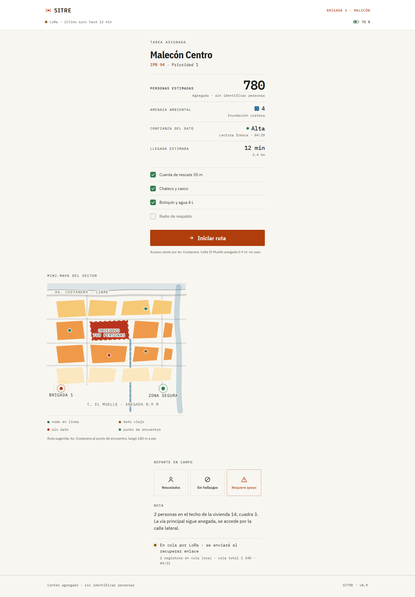

# Rallylatam — presentación

2 capturas generadas automáticamente. Vista local: `npm run serve`.

-   `paginas/01-plataforma.html`
-   `paginas/02-brigadas.html`

<!-- manual -->
> Todo lo que va **debajo de esta línea** está escrito a mano, y `npm run capture` lo respeta:
> regenera la galería de arriba y conserva este bloque. Añadir aquí, no arriba.

# Qué hay en `presentacion/`

Esta carpeta es la entrega: **imágenes y clips**, no una app. Sale toda del prototipo o del carril 3D.

## 1. Capturas del prototipo

| archivo | qué es | tamaño |
| --- | --- | --- |
| `01-01-plataforma.png` | **La plataforma nacional completa**, de arriba abajo: 11 secciones, del país al nodo. Es el still grande de referencia. | 1440×10419 |
| `02-brigadas-movil.png` | La pantalla de brigada **a ancho de teléfono** (430 px). Esta es la que sirve para el video. | 860×4008 |
| `02-02-brigadas.png` | La misma pantalla a 1440 px: enseña que el diseño es responsive. No es un still de producto. | 1440×2068 |

## 2. Exploración de look (Fase 1 — histórico)

Los candidatos de tema sobre la misma pantalla, y la hoja que los compara. **El tema está congelado
en `institucional`** (papel cálido, IBM Plex): es el tema activo del prototipo y el que sale en todo
lo demás de esta carpeta. Estos archivos quedan como registro de la decisión.

- `01-look-4-temas.png` — la hoja comparativa de los cuatro temas.
- `02-hero-claro.png` · `02-hero-natural.png` · `02-hero-oscuro.png` · `02-hero-blueprint.png` — los cuatro candidatos.
- `03-hero-movil.png` — el hero móvil de esa fase.

## 3. Material de rodaje

Toda la entrega de video está en **`presentacion/video/`**, y su índice es
**`presentacion/video/material.md`** (clips, duraciones, para qué sirve cada toma, orden de montaje
sugerido y cómo se regraba).

- `presentacion/video/t*.{mp4,webm,png}` — la plataforma nacional, 9 tomas, 1920×1080.
- `presentacion/video/movil/m*.*` — la pantalla de brigada, 4 tomas, 540×1170.
- Los `.png` de cada clip son su fotograma final, a 2×.

## 4. Carril 3D (VIGÍA-07 · Blender)

Pieza distinta del mismo pitch: el equipo de campo físico renderizado en sus 3 ubicaciones clave (producto aislado en fondo transparente, estación completa de sensores en campo/montaña, y nodo instalado en la cubierta del centro comercial). Su contrato es
`CONTRATO.md` §7–§8 y su guía es **`presentacion/video/material-3d.md`**.

- `presentacion/video/3d-*.mp4` — clips preexistentes disponibles. **Renderizado de nuevos clips de video finalizado/detenido** para aliviar la carga de CPU y memoria de la PC.
- `presentacion/3d/rev-*.png` — stills definitivos en alta calidad de las 3 ubicaciones.

✔️ **Estado:** modelado 3D terminado y congelado en las 3 ubicaciones. Renders de video cerrados.

## 5. Revisión interna

`presentacion/_review/` — franjas del ensamblado que usé para revisar continuidad entre secciones.
**No es material de entrega**; se puede vaciar.

## 6. Cómo se regenera

```bash
npm run build                 # compone paginas/ desde secciones/
npm run capture               # las capturas de arriba + este md
npm run video -- --guion guion.json --preset 16x9 --scale 2 --mp4 --stills --fps 30
npm run video -- --guion guion-movil.json --width 540 --height 1170 --scale 2 --mp4 --stills --fps 30 --out presentacion/video/movil
```
